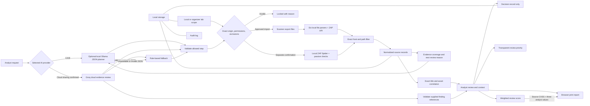

# ScopeWeave architecture

## Data flow

## Trust boundaries

- `server.py` serves the app on `127.0.0.1` only and talks to ZAP at the fixed loopback API `127.0.0.1:8080`.
- The planner uses an explicitly selected provider. Local Ollama returns a two-field JSON suggestion; Groq cloud returns a structured evidence review and next-step suggestion. Both next-step actions must belong to the saved scope-permitted action list. Invalid or unavailable output uses the deterministic local rule fallback. A separate confirmed action starts only a ZAP Spider crawl with passive checks; no active scanner or exploit validation is called.
- The local Ollama request contains a compact registered-scope summary and up to 25 finding summaries. It is sent only to `127.0.0.1:11434`; imported evidence is treated as untrusted text. Ollama cannot start scans.
- Groq is an optional network trust boundary. Its request requires the Groq provider selection and explicit per-request cloud-sharing consent. The server sends the registered origin, prompt, exclusions, allowed actions, and at most 10 finding summaries. Each finding's summary text is limited to 240 characters, with at most three source excerpts of 180 characters each. It omits the organizer approval reference and original report files. The default model is `openai/gpt-oss-120b` hosted by Groq; this is not the OpenAI Platform API. Each cloud request is attempted once and has a 2,200 completion-token cap.
- `GROQ_API_KEY` is read by the Python server from its environment and sent only as the provider authentication credential. It is not returned to the browser, included in the model prompt, stored in browser local storage, or written by the setup launcher. `start-groq.ps1` reads the key through a hidden prompt, limits it to the server session, and restores the previous process environment on exit.
- Groq output is checked for the expected JSON shape, allowed next-step action, and references to finding IDs included in the request. The browser escapes model text and links observations to those findings. A known finding ID establishes provenance, not correctness: AI explanations remain analyst-review material. Selected input is bounded, so the response does not represent all findings when the scope has more than 10 groups.
- Before the crawl, the server creates a temporary ZAP context with the exact registered origin and excluded paths. The Spider is constrained to that context and subtree, with a three-minute timeout and a 50-child-per-node limit. Results are returned through the existing ZAP JSON import and exact scope filter.
- The analyst records the exact origin, authorization basis, reference, exclusions, permissions, and attestation in browser storage. A self-owned local practice lab accepts only `127.0.0.1`, `localhost`, or `::1`. Organizer-approved lab records retain their existing permissions.
- Imported records are accepted only when their host matches the registered scope. URL records also need the exact origin and a non-excluded path. Host aliases are not inferred.
- Correlation merges exact normalized title and asset matches. Each source keeps its own reported severity, CVSS, identifiers, confidence, timestamp, validation status, file name, reference, and evidence.
- Approval and rejection buttons require the saved `Layer review` permission and write a local decision record only. There is no active validation executor.
- The report is rendered as HTML in a new browser tab and printed to PDF. All imported text is HTML-escaped.

## Current capability status

| Area | Implemented status |
|---|---|
| Scope registration | Exact HTTP(S) origin, approval reference, normalized excluded paths, action groups, active-scope switching, and analyst attestation; action-specific controls are gated by saved permissions |
| Planning | Optional local Ollama next-step suggestion or explicitly consented Groq cloud evidence review; action allowlist, response validation, supplied-finding reference checks, and labelled local rule fallback |
| Groq portability | Python standard-library HTTP client, server-side environment key, secure PowerShell launcher, and account-dependent cloud access; a live successful request must be verified separately from mocked tests |
| OWASP ZAP | Local Spider crawl + passive checks through loopback API; JSON file import also supported |
| Nmap, Nessus, Greenbone, Nikto, Burp | Local file import only |
| Evidence coverage | Per-scope latest import outcome, file count, linked finding groups, and a rule-based next-review suggestion; missing files are not treated as a clean result |
| Normalization/correlation | Exact title + asset; per-source evidence preserved |
| Evidence trace | Expandable source tool, source filename, timestamp, parser reference, parsed evidence text, and observed label; original file text and exact source line numbers are not retained |
| Imported evidence warning | Pattern matches in parsed scanner text are shown with their source. The Groq sharing panel lists flagged fields for the pending review and excludes them by default from the request copy. Stored evidence stays available locally. |
| Cross-tool agreement | Unique source-tool count for normalized title + asset: one is Low; two or more are Medium; no automatic confirmation tier |
| Import audit | Per-file imported, partial, empty, out-of-scope, blocked, and failed outcomes are stored and reported |
| Prioritization | Source severity starts the review tier; low/unknown confidence is flagged. A separate weighted score uses source CVSS and analyst-entered 0–10 exposure, exploitability, and asset-impact scores only when all four values exist |
| Human oversight | Approval/rejection audit demo; approval is not execution |
| Audit log | Local table with actor, action, time, and result; browser storage is not tamper-proof |
| Failure recovery | Invalid imports and local ZAP errors show a recorded reason and recovery hint |
| Reporting | Six-section print-ready report with scope/authorization, methodology and integration matrix, coverage, findings and weighted score components, provider-labelled review, approvals, and limitations |

## Planned items

Metasploit integration, a “why skipped” action log, and direct links from a finding to its exact source-file line are planned. Source-line links need parsers that preserve reliable line positions; current references point to scanner records, not file lines.

The organizer reference is a local attestation field, not a verification service. Browser local storage is not encrypted or tamper-proof. Treat the computer and exported reports as sensitive. Additional live integrations need organizer-defined targets and permitted actions.
